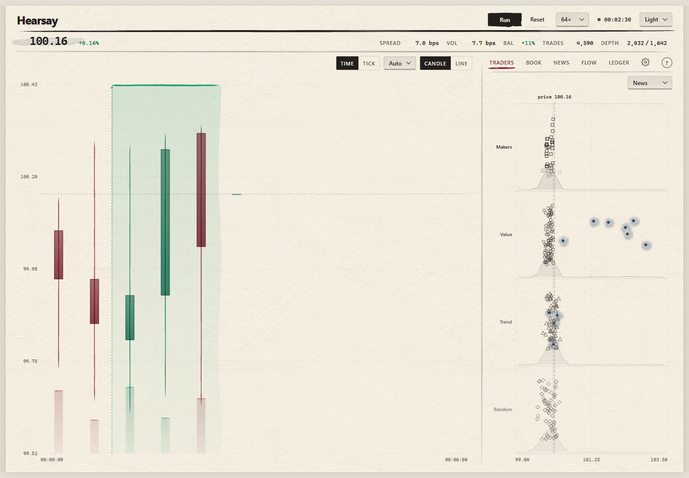

# Hearsay

A synthetic order-book market with 250 traders, four strategies, and private information, packaged as a web component.

[Open the app](https://jjjpanda.github.io/marketsim/) · [Embed view](https://jjjpanda.github.io/marketsim/embed/)



## Market

Traders submit limit and market orders to a continuous double-auction order book. News shifts the underlying asset value immediately; private knowledge spreads along a logistic curve until public release, creating bursty insider order flow and price discovery across four archetypes.

| Strategy | Behavior |
| --- | --- |
| Makers | Quote both sides of the book, leaning prices and sizes with inventory and volatility. |
| Value seekers | Trade when price gives at least a two-tick edge over their inventory-adjusted estimate. |
| Trend followers | Follow quote-midpoint momentum, constrained by value bounds once informed. |
| Random traders | Submit noisy orders within cash and share limits. |

## Controls

| Key / Gesture | Action |
| --- | --- |
| Space | Run / pause |
| R | Reset |
| N | Start a news episode |
| Left / Right / Esc | Inspect traders when the field has focus |
| Drag / Shift + wheel / double-click | Pan price history / snap back to live |

## Embed

### Hosted iframe

```html
<iframe
  src="https://jjjpanda.github.io/marketsim/embed/?preset=balanced&amp;theme=dark&amp;seed=24816&amp;speed=64&amp;autoplay=false"
  title="Hearsay simulation"
  width="800"
  height="450"
  loading="lazy"
  style="border: 0"
></iframe>
```

`/embed/` fills the frame with the price and the chart. The live order book sits on the chart edge. Set everything else with the [Options](#options).

### Web component

```sh
npm install ../marketsim
```

```js
import 'marketsim';
```

```html
<market-ecosystem embed width="800" height="450" theme="light"
  preset="thin" seed="24816" speed="16" autoplay="false"></market-ecosystem>
```

## Options

Use URL parameters for the iframe, or HTML attributes (`setAttribute()` works) for the component.

| Option | Default | Purpose |
| --- | --- | --- |
| `embed` | absent | Compact view; always on for `/embed/`. |
| `theme` | `dark` | `dark` or `light`. |
| `preset` | `balanced` | `balanced`, `trend`, or `thin`. |
| `seed` | `24816` | Whole number, `0`–`4294967295`. |
| `population` | `250` | Number of traders, `8`–`5000`. |
| `speed` | `64` | `1`, `4`, `16`, `64`, `128`, or `256`× speed. |
| `autoplay` | on | `false` starts paused. |
| `transparent`, `autofocus` | absent | Transparent background or initial focus (`true` or bare). |
| `width`, `height` | automatic | Positive pixels, capped at `4096` / `2160`. |
| `panels` | all | Comma-separated panel list (`history`, `field`, `book`, `episode`, `flow`, `diagnostics`, `conditions`). |

## Development

Requires Node 22 or newer. No runtime dependencies.

```sh
npm run dev
npm test
npm run build
npm run verify
```

Open `http://127.0.0.1:4180`. `npm run benchmark` times simulation steps and `npm run check:browser` runs headless browser checks.
